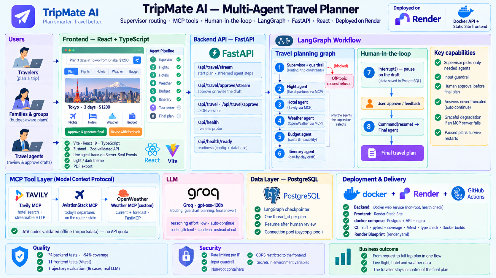
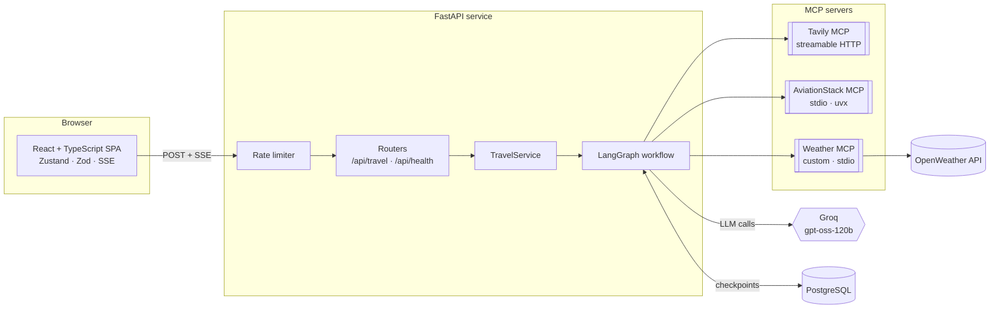
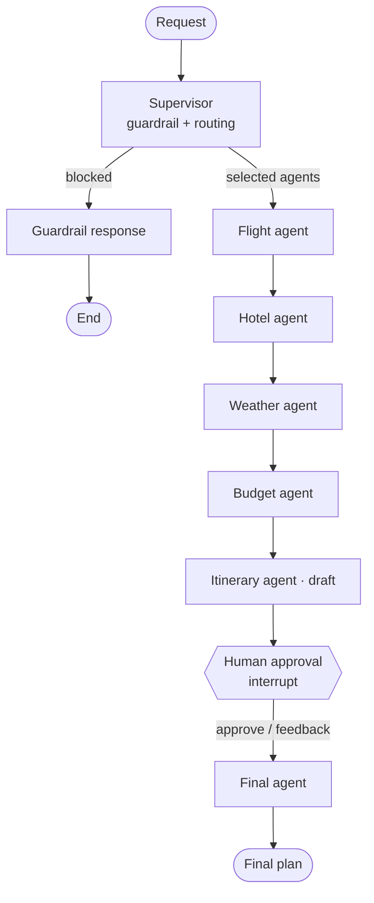

<div align="center">

# ✈️ TripMate AI

**A production-structured, multi-agent travel planner built with LangGraph, MCP, FastAPI and React.**

Describe a trip in plain language. A supervisor agent routes the request to specialist agents (flights, hotels, weather, budget), drafts an itinerary, and **pauses for your review** before producing the final plan. Every agent step is streamed live to the UI.

**Live demo:** https://tripmate-web-bcd8.onrender.com (free hosting: the first request after a pause can take about a minute while the backend wakes up)

[](https://github.com/MamitianaRak/TripeMate-AI-A-Multi-Agent-Travel-Planner/actions/workflows/ci.yml)


</div>

---

## Table of Contents

- [The problem](#the-problem)
- [Key features](#key-features)
- [Architecture](#architecture)
- [Agent workflow](#agent-workflow)
- [Human-in-the-loop](#human-in-the-loop)
- [Tech stack](#tech-stack)
- [Project structure](#project-structure)
- [Getting started](#getting-started)
- [Configuration](#configuration)
- [Testing and CI](#testing-and-ci)
- [Deployment](#deployment)
- [API reference](#api-reference)
- [Engineering decisions](#engineering-decisions)
- [Known limitations](#known-limitations)
- [Roadmap](#roadmap)
- [License](#license)

## The problem

Planning a trip means juggling flight trackers, hotel sites, weather forecasts and a budget spreadsheet, then stitching it all into a plan. A single LLM prompt can produce a plan, but it hallucinates live data, wastes calls on information you did not ask for, and gives you no chance to correct it before it is "final".

TripMate AI treats trip planning as an **agentic workflow**:

- a **supervisor** decides which specialists are actually needed for this request;
- **specialists** fetch live data through **MCP servers** instead of guessing;
- a **guardrail** rejects off-topic or harmful requests before any tool runs;
- a **human approval step** lets the traveler approve or redirect the draft;
- the whole run is **checkpointed in PostgreSQL**, so a paused plan survives restarts.

> **Example:** *"Plan a 3-day trip to Tokyo from Dhaka with a budget of $1200."*

## Key features

| Area | What it does |
|------|--------------|
| **Supervisor routing** | Extracts trip constraints (destination, origin, duration, budget, style) and runs only the agents the request needs. |
| **Input guardrail** | Blocks requests unrelated to travel, or harmful, before any agent or tool runs. Fails open on parsing errors. |
| **MCP tool layer** | Hotels via Tavily MCP (HTTP), today's live departures on the requested route via AviationStack MCP (stdio), weather via a **custom OpenWeather MCP server**. |
| **Human-in-the-loop** | The graph pauses with LangGraph `interrupt()` on the draft; the user approves or sends feedback; `Command(resume=...)` continues the run. |
| **Live streaming** | Server-Sent Events stream one event per finished agent and **the draft and final plan token by token**, so text appears while it is being written; the UI also shows a live pipeline with per-agent status, timing and skipped agents. |
| **Resilience** | A failing MCP server degrades its agent instead of failing the request; provider rate limits and timeouts map to clear 503/504 errors. |
| **Complete answers, never truncated** | Answers cut by the output limit are automatically continued; prompts over budget are condensed by the LLM (facts kept) instead of being cut. |
| **Production hygiene** | Typed settings, structured JSON logs with request IDs, rate limiting, CORS, health/readiness probes, non-root containers, CI. |
| **Workspace UI** | Two-column layout, trip summary, tabs for each specialist's raw results, quick-feedback chips, light and dark themes, PDF export. |

## Architecture



The diagrams below detail the request flow and the agent graph.



**Request flow**

1. The SPA posts the request to `/api/travel/stream` and reads the SSE stream.
2. `TravelService` runs the compiled LangGraph graph with a new `thread_id`.
3. Each finished node emits a `step` event, and the itinerary agent streams its draft as `token` events while writing it; the run stops at the approval interrupt and emits a `result` event with the draft.
4. The user's decision is posted to `/api/travel/approve/stream`, which resumes the same thread from its PostgreSQL checkpoint.

## Agent workflow



Specialists run in a fixed order, but **only the ones the supervisor selected** are visited; the itinerary agent always runs.

| Agent | Responsibility | Source |
|-------|----------------|--------|
| `supervisor` | Guardrail check, agent selection, trip-constraint extraction | Groq |
| `flight_agent` | Resolves origin and destination airports, fetches today's departures on that route, then summarizes airlines, flight numbers, duration, fare range and booking advice | AviationStack MCP + airportsdata + Groq |
| `hotel_agent` | Top 5 hotels for the destination, condensed to name, link and one-line summary | Tavily MCP |
| `weather_agent` | Current conditions and forecast for the destination | Weather MCP (custom) |
| `budget_agent` | Cost categories, risks, savings and feasibility | Groq |
| `itinerary_agent` | Compact day-by-day draft from all collected results | Groq |
| `human_approval` | Pauses the graph until the user decides | LangGraph `interrupt()` |
| `final_agent` | Polishes the approved draft, or rewrites it following the feedback | Groq |

## Human-in-the-loop

```text
POST /api/travel/stream
  supervisor → specialists → itinerary_agent → human_approval: interrupt()
  ← state saved in PostgreSQL, SSE "result" with status=awaiting_approval

POST /api/travel/approve/stream   { thread_id, approved, feedback }
  Command(resume={approved, feedback}) → human_approval returns the decision
  → final_agent → SSE "result" with status=completed
```

- The API checks the thread is actually waiting for approval: unknown threads return **404**, completed ones **409**.
- Rejecting a draft requires feedback (**400** otherwise).
- A revision is applied once; the revised plan is not sent back for a second approval (see [Roadmap](#roadmap)).

## Tech stack

| Layer | Technology |
|-------|------------|
| Agents | LangGraph (state graph, conditional routing, `interrupt`/`Command`), LangChain Core |
| LLM | Groq · `openai/gpt-oss-120b` (configurable) |
| Tools | MCP via `mcp` and `langchain-mcp-adapters`; Tavily, AviationStack, custom FastMCP weather server |
| API | FastAPI, Pydantic v2, pydantic-settings, Server-Sent Events, Uvicorn |
| Persistence | PostgreSQL · `langgraph-checkpoint-postgres` with a `psycopg_pool` connection pool |
| Frontend | React 19, TypeScript, Vite, Zustand, Zod, lucide-react, react-markdown, html2pdf.js |
| Quality | Pytest + coverage (fake LLM and tools, no network), Ruff, Vitest + Testing Library |
| Delivery | Docker (non-root, health check), nginx, Docker Compose, Render Blueprint, GitHub Actions |

## Project structure

```text
.
├── app/                          # FastAPI backend
│   ├── main.py                   # App factory, lifespan wiring, middleware
│   ├── api/                      # HTTP layer
│   │   ├── travel.py             #   JSON + SSE endpoints
│   │   ├── health.py             #   liveness / readiness probes
│   │   ├── schemas.py            #   request / response models
│   │   ├── deps.py               #   service injection, rate limiting
│   │   └── errors.py             #   consistent {success, error, code} errors
│   ├── core/                     # Cross-cutting concerns
│   │   ├── config.py             #   typed settings from env / .env
│   │   ├── logging.py            #   text or JSON logs with request IDs
│   │   ├── llm.py                #   LLM factory (timeouts, retries)
│   │   ├── errors.py             #   provider error classification
│   │   └── rate_limit.py         #   sliding-window limiter
│   ├── agents/                   # LangGraph workflow
│   │   ├── graph.py              #   graph construction and routing
│   │   ├── nodes.py              #   agent implementations
│   │   ├── prompts.py            #   all prompt templates
│   │   ├── state.py              #   TravelState and constants
│   │   ├── text.py               #   condensing helpers
│   │   └── tools.py              #   tool interface (Protocol)
│   ├── integrations/
│   │   └── mcp_toolbox.py        # MCP client implementing the tool interface
│   ├── mcp_servers/
│   │   └── weather_server.py     # Custom OpenWeather MCP server
│   └── services/
│       └── travel_service.py     # Start / resume / stream use cases
├── frontend/                     # React + TypeScript SPA
│   ├── src/api/                  #   typed client, Zod schemas, SSE parser
│   ├── src/store/                #   Zustand plan state machine
│   ├── src/components/           #   planner, agent pipeline, workspace, approval
│   ├── Dockerfile                #   multi-stage build → nginx
│   └── nginx.conf.template       #   SPA + /api proxy with buffering off
├── tests/                        # Pytest suite (fakes, no network)
├── .github/workflows/ci.yml      # Lint, tests, builds
├── Dockerfile                    # API image
├── docker-compose.yml            # PostgreSQL + API + frontend
├── render.yaml                   # Render Blueprint
├── .env.example                  # Configuration template
└── run.py                        # Local dev entry point
```

## Getting started

### Prerequisites

- Python 3.12, Node.js 24
- PostgreSQL (local, Docker or hosted)
- [`uv`](https://docs.astral.sh/uv/), which provides `uvx` to launch the AviationStack MCP server
- API keys: [Groq](https://console.groq.com/), [Tavily](https://tavily.com/), [AviationStack](https://aviationstack.com/), [OpenWeather](https://openweathermap.org/api)

### 1. Backend

```bash
git clone https://github.com/MamitianaRak/TripeMate-AI-A-Multi-Agent-Travel-Planner.git
cd TripeMate-AI-A-Multi-Agent-Travel-Planner

python -m venv .venv
source .venv/bin/activate          # Windows: .venv\Scripts\activate
pip install -r requirements-dev.txt

cp .env.example .env               # then fill in the keys and DATABASE_URL
python run.py                      # http://127.0.0.1:8000/docs
```

The checkpoint tables are created on first start. If a required variable is missing, the app refuses to start and names it.

### 2. Frontend

```bash
cd frontend
npm ci
npm run dev                        # http://localhost:5173
```

In development, Vite proxies `/api` to `http://127.0.0.1:8000`, so no CORS setup is needed.

### Alternative: everything with Docker Compose

```bash
cp .env.example .env               # fill in the API keys
docker compose up --build          # http://localhost:8080
```

Compose starts PostgreSQL, the API and the nginx-served frontend; the database URL is set for you.

## Configuration

All settings are read from the environment (or `.env`) by [`app/core/config.py`](app/core/config.py). See [`.env.example`](.env.example) for the full list.

| Variable | Required | Default | Description |
|----------|----------|---------|-------------|
| `GROQ_API_KEY` | Yes | | Groq API key |
| `TAVILY_API_KEY` | Yes | | Hotel search (Tavily MCP) |
| `AVIATIONSTACK_API_KEY` | Yes | | Live departure boards (AviationStack MCP, free plan is enough) |
| `OPENWEATHER_API_KEY` | Yes | | Weather (custom MCP server) |
| `DATABASE_URL` | Yes | | PostgreSQL connection string |
| `DATABASE_SSLMODE` | No | `require` | Appended to the URL when it has no `sslmode`; use `disable` for a local Postgres |
| `GROQ_MODEL` | No | `openai/gpt-oss-120b` | Model name |
| `LLM_TIMEOUT_SECONDS` / `LLM_MAX_RETRIES` | No | `60` / `2` | LLM client resilience |
| `LLM_REASONING_EFFORT` | No | `low` | Reasoning effort of `gpt-oss`; leaves more output tokens for the answer (empty for non-reasoning models) |
| `LLM_MAX_CONTINUATIONS` | No | `2` | Times a truncated answer is continued |
| `PROMPT_BUDGET_TOKENS` | No | `4000` | Prompt size above which sections are condensed by the LLM |
| `CORS_ORIGINS` | No | `http://localhost:5173` | Comma-separated allowed origins |
| `RATE_LIMIT_REQUESTS` / `RATE_LIMIT_WINDOW_SECONDS` | No | `10` / `60` | Per-IP limit on `/api/travel*` (`0` disables) |
| `TRUST_PROXY_HEADERS` | No | `false` | Read the client IP from `X-Forwarded-For` (enable only behind a proxy) |
| `LOG_LEVEL` / `LOG_JSON` | No | `INFO` / `false` | Log verbosity and JSON log lines |
| `VITE_API_BASE_URL` | Frontend | empty | API URL when the frontend is hosted separately |

## Testing and CI

```bash
pytest --cov=app            # backend: 65 tests, ~94% coverage, no network
ruff check app tests        # lint
cd frontend && npm test     # frontend: Vitest + Testing Library
npm run typecheck && npm run build
```

- The backend suite runs the **real compiled graph** with a fake LLM, fake MCP tools and an in-memory checkpointer. It covers routing, the guardrail, the interrupt/resume flow, degraded MCP servers, SSE streaming, error mapping and rate limiting.
- The frontend suite mocks `fetch` with chunked SSE streams and tests the full draft → approve flow, validation and error display.
- [GitHub Actions](.github/workflows/ci.yml) runs both suites on every push and pull request, then builds both Docker images with layer caching.

## Deployment

### Render (Blueprint)

[`render.yaml`](render.yaml) defines the Docker API service and the static frontend. It reuses an existing Render PostgreSQL database, since Render allows a single free database per account.

1. Create a PostgreSQL database on Render if you do not have one, and copy its **Internal Database URL**.
2. In Render, choose **New → Blueprint** and select this repository.
3. Fill in the secret values when prompted: `DATABASE_URL`, the four API keys and `CORS_ORIGINS` (frontend URL) on the API, and `VITE_API_BASE_URL` (API URL) on the frontend.
4. Deploy, then check `https://<api-service>.onrender.com/api/health`.

The API image runs as a non-root user, listens on `$PORT`, exposes a Docker health check and pre-installs the AviationStack MCP server so the first request does not download it.

### Health probes

- `GET /api/health`: liveness, always `200` while the process is up.
- `GET /api/health/ready`: readiness, checks configuration and the checkpoint database, returns `503` when degraded.

## API reference

Interactive documentation is served at `/docs`. All errors share one shape:

```json
{ "success": false, "error": "Human-readable message", "code": "machine_code" }
```

| Method | Path | Description |
|--------|------|-------------|
| `POST` | `/api/travel` | Start a plan; returns when the draft is ready |
| `POST` | `/api/travel/approve` | Approve or revise the draft; returns the final plan |
| `POST` | `/api/travel/stream` | Same as `/api/travel`, as Server-Sent Events |
| `POST` | `/api/travel/approve/stream` | Same as `/api/travel/approve`, as Server-Sent Events |
| `GET` | `/api/health` | Liveness probe |
| `GET` | `/api/health/ready` | Readiness probe |

**Start a plan**

```bash
curl -N -X POST http://127.0.0.1:8000/api/travel/stream \
  -H "Content-Type: application/json" \
  -d '{"message": "Plan a 3-day trip to Tokyo from Dhaka with a budget of $1200"}'
```

```text
event: step
data: {"node": "supervisor", "label": "Supervisor", "thread_id": "trip_3f2a…", "selected_agents": ["flight_agent", "hotel_agent", "itinerary_agent"], …}

event: step
data: {"node": "flight_agent", "label": "Flight Agent", "thread_id": "trip_3f2a…"}

…

event: token
data: {"node": "itinerary_agent", "text": "## Day 1"}

event: token
data: {"node": "itinerary_agent", "text": " — Arrival in Tokyo"}

…

event: result
data: {"thread_id": "trip_3f2a…", "status": "awaiting_approval", "requires_approval": true, "answer": "<draft itinerary>", …}
```

| Event | When | Payload |
|-------|------|---------|
| `step` | An agent has finished | `node`, `label`, `thread_id` (+ routing details for `supervisor`) |
| `token` | The itinerary or final agent is writing | `node`, `text` (append in order; the concatenation equals the final text) |
| `result` | The run paused for approval or completed | Full result object (see below) |
| `error` | The run failed mid-stream | `{success: false, error, code}` |

Only user-facing text is streamed: supervisor JSON, specialist analyses and internal condensing calls are never sent as tokens.

**Review the draft**

| Field | Type | Required | Description |
|-------|------|----------|-------------|
| `thread_id` | string | Yes | Returned by the start call |
| `approved` | boolean | Yes | `true` to approve, `false` to request a revision |
| `feedback` | string | When `approved` is `false` | Revision instructions |

```bash
curl -X POST http://127.0.0.1:8000/api/travel/approve \
  -H "Content-Type: application/json" \
  -d '{"thread_id": "trip_3f2a…", "approved": false, "feedback": "Cheaper hotels and one free day"}'
```

**Result fields:** `thread_id`, `status` (`awaiting_approval` | `completed`), `requires_approval`, `answer`, `approval_request`, `itinerary`, `flight_results`, `hotel_results`, `weather_results`, `budget_results`, `selected_agents`, `trip_constraints`, `supervisor_reasoning`, `guardrail_allowed`, `guardrail_reason`, `approved`, `human_feedback`, `llm_calls`.

| Status | Code | When |
|--------|------|------|
| 400 | `invalid_request` | Empty message, missing feedback on rejection, invalid body |
| 404 | `thread_not_found` | Unknown `thread_id` on review |
| 409 | `no_pending_approval` | The plan is not waiting for approval |
| 429 | `rate_limited` | Too many requests from this IP (`Retry-After` header set) |
| 503 | `llm_rate_limited` / `upstream_unavailable` | Provider rate limit or outage |
| 504 | `upstream_timeout` | An external service timed out |
| 500 | `internal_error` | Unexpected failure (details only in server logs) |

On the streaming endpoints, failures that happen mid-run arrive as an `error` event with the same body.

## Engineering decisions

- **Dependency injection for testability.** The graph is built by `build_travel_graph(llm, tools, checkpointer)`. Agents depend on a `TravelTools` protocol, not on MCP, so the full workflow runs in tests with fakes and no network.
- **App factory and lifespan.** Nothing connects at import time; the database pool, MCP client and LLM are created in the FastAPI lifespan and closed on shutdown.
- **Connection pool for checkpoints.** `PostgresSaver` uses a `psycopg_pool` pool rather than one shared connection, so concurrent requests do not serialize on a single socket.
- **Sync endpoints on purpose.** The graph and the MCP calls are blocking, so the endpoints are plain `def`: FastAPI runs them in a threadpool and the event loop stays free. SSE streams are driven from one dedicated worker thread so LangGraph's context variables stay valid.
- **Graceful degradation.** Each specialist catches its own tool failures and returns a clear "unavailable" note, so one MCP outage still produces a plan.
- **Errors that do not leak.** Known provider failures map to actionable 503/504 responses; unexpected errors return a generic message while the stack trace goes to the logs with the request ID.
- **No truncated answers.** LLM output is never trimmed. When the model stops on its output limit (`finish_reason="length"`), it is asked to continue from where it stopped, up to `LLM_MAX_CONTINUATIONS` times. When a prompt would exceed `PROMPT_BUDGET_TOKENS`, the largest sections are condensed by the LLM with an instruction to keep every fact; the reviewed draft is condensed last. `reasoning_effort=low` keeps `gpt-oss` from spending its output budget on reasoning.
- **Fewer LLM calls.** The weather agent reuses the destination extracted by the supervisor instead of making its own extraction call.
- **Route-specific flights within the free plan.** The supervisor proposes IATA codes, which are validated offline against `airportsdata` (no quota used, invented codes rejected, city-name fallback). The flight agent then reads one departure board, the only route-capable AviationStack feature on the free plan, and keeps flights landing at any airport of the destination city (e.g. NRT and HND for Tokyo), with codeshares removed.
- **Secrets stay out of logs.** HTTP client logging is lowered so the Tavily MCP URL (which carries the key) is never written to logs; `.env` is excluded from Docker images and git.

## Known limitations

- **No live fares.** AviationStack provides schedules, not prices; fare ranges are LLM estimates and are labeled as such.
- **Direct flights, today only.** Live data comes from today's departure board of the origin airport (first 100 departures), so connecting itineraries and future dates rely on the LLM's general knowledge, flagged as not live.
- **AviationStack free-plan quota.** Each plan that includes the flight agent uses one API request (100 per month on the free plan).
- **Per-instance rate limiting.** The limiter is in memory; several API instances would need a shared store such as Redis.
- **No authentication.** The API is public, protected only by rate limiting and CORS.
- **Single revision round.** After feedback, the final plan is generated once without a second approval.
- **Groq free tier.** `openai/gpt-oss-120b` is limited to 8,000 tokens per minute on the free tier; heavy use triggers `503 llm_rate_limited`.

## Roadmap

- [x] Route-specific live flight lookup
- [ ] Real fares and connecting itineraries (e.g. Amadeus or Duffel)
- [ ] Multiple revision rounds before finalizing
- [ ] Parallel execution of independent specialists
- [ ] Offline evaluation set for plan quality
- [ ] LangSmith tracing dashboard and metrics
- [ ] User accounts and saved trips

## License

Distributed under the MIT License. See [LICENSE](LICENSE).
